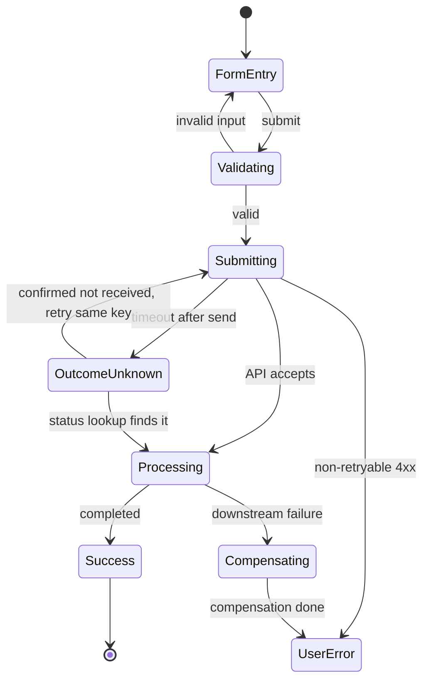

# Flow map

Map every system state and transition of a feature, happy, failure, timeout, and recovery, before
implementation. Every path becomes a test case.

## Workflow context
- Boundary: this is the system's view (states, failure classes, concurrency, cleanup). `user-flow`
  is the user's view (screens, choices, messages). Reuse its journeys as entry paths; do not
  design screens or copy here.
- Follows `user-flow`, `design-doc`, `api-design`. Feeds `spec-to-impl` and `test-plan`.

## Inputs (ask only if missing)
Spec or PRD (or upstream handoff), endpoints involved, external dependencies, roles and permissions.

## How to map it
1. **Happy path first**: name every state the system passes through and every transition.
2. **Input validation**: per input, what can be invalid (empty, too long, wrong format or type,
   negative, out of range, injection). Group inputs that fail the same way into one path.
3. **Auth and authz**: no token, expired token, wrong role, wrong tenant, deleted or disabled user.
4. **External calls** (DB, API, queue, cache): timeout, refused connection, 5xx, malformed or
   partial response. A timeout after the request was sent means the outcome is **unknown**, not
   failed: map an unknown state resolved by status lookup or reconciliation.
5. **Concurrency**: two actors on the same resource, double submit, lost updates on counters or
   balances. Name the guard (optimistic lock, idempotency key, unique constraint).
6. **Recovery** per failure: retry (only for idempotent or idempotency-keyed operations, bounded by
   the operation's semantics and the provider's limits), surface an error, roll back, compensate,
   dead-letter, or hand to a person.
7. **Cleanup**: for every allocated resource (rows, uploads, messages, external reservations), what
   releases it on each failure path. Financial records are reversed with compensating entries,
   never deleted.

## Output format

### State diagram (Mermaid)


### Path table
| # | Path | Entry state | Exit state | Trigger | Side effects | Cleanup | Test case |
|---|------|-------------|-----------|---------|-------------|---------|-----------|
| 1 | Happy path | FormEntry | Success | Valid submit | Row written, email queued | None | TC-001 |
| 2 | Validation fail | FormEntry | FormEntry | Invalid input | None | None | TC-002 |
| 3 | Timeout after send | Submitting | OutcomeUnknown | API timeout | Pending record | Resolved by lookup | TC-003 |
| 4 | Auth expired | Any | Login | Token expired | None | None | TC-004 |
| 5 | Concurrent edit | Processing | ConflictError | Version mismatch | None | None | TC-005 |
| 6 | Downstream fail | Processing | Compensating | Provider rejects | Partial state | Compensating action | TC-006 |

### Cleanup inventory
| Resource | Allocated when | Released when | Orphan risk | Mechanism |
|----------|---------------|---------------|-------------|-----------|
| Upload | Step 2 | Attached in step 6 | Steps 3-5 fail | Scheduled cleanup |
| Queue message | Step 4 | Consumer acks | Consumer crashes | Dead-letter queue |

## Anti-patterns to flag
- Happy path only, or external calls assumed to succeed.
- "TODO: handle error" on any path.
- A timeout treated as a failure for a non-idempotent operation.
- Allocated resources with no cleanup on failure.
- Concurrency dismissed ("users won't do that").
- Unbounded retry, or retry of an operation with no idempotency guarantee.

## Quality bar
- Every external dependency has its failure paths mapped.
- Every allocation has a cleanup path.
- Unhandled transitions are listed explicitly as out of scope, with a reason.
- Every path has a test case ID; every shared mutable resource has its concurrency case.
- The Mermaid diagram renders.

## Output contract
```yaml
produces:
  - type: flow-map
    format: markdown
    path: "claudedocs/<feature>-flow-map.md"
    sections: [state_diagram, path_table, cleanup_inventory]
    generates_test_cases: true
    handoff: "Write claudedocs/handoff-flow-map-<timestamp>.yaml - suggest: spec-to-impl, test-plan"
```
